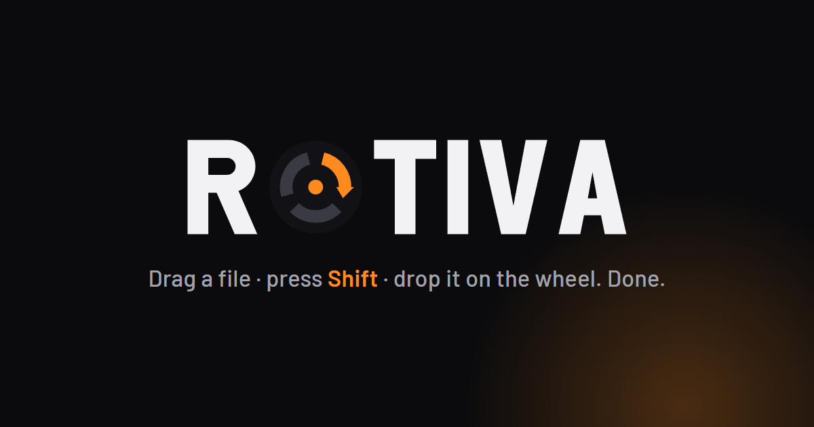
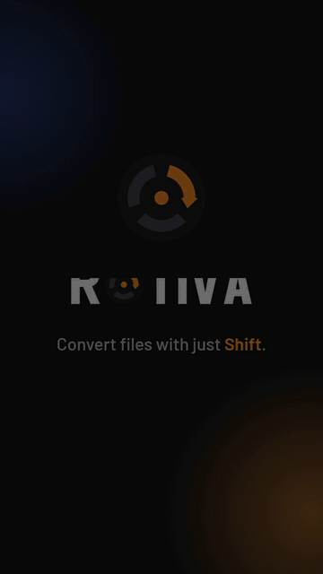
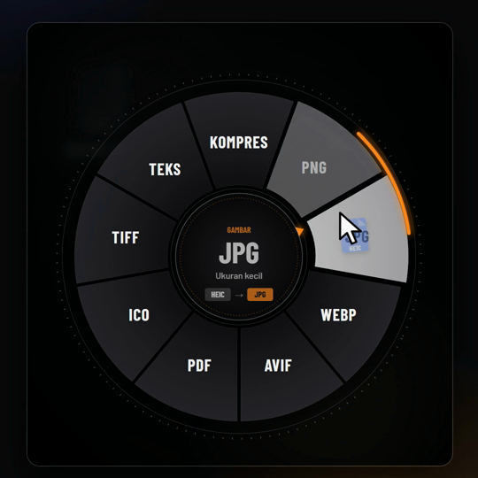
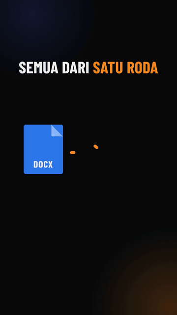

  

  <b>Convert files without opening any app.</b> 
  Drag a file, press <kbd>Shift</kbd>, drop it on the wheel — done.

  
  
  
  

  <a href="https://uncrownedk1ng2812.github.io/rotiva/"><b>🌐 Website & live demo</b></a>
  &nbsp;·&nbsp;
  <a href="https://github.com/uncrownedk1ng2812/rotiva/releases/latest"><b>⬇️ Download the installer</b></a>
  &nbsp;·&nbsp;
  <a href="https://ko-fi.com/denishchairany"><b>☕ Support on Ko-fi</b></a>

---

> [!IMPORTANT]
> **Rotiva was built from scratch by Denish Chairany. All rights reserved.**
> This repository is **not for forking, copying or redistribution.** You're free to download and use
> the app, but Rotiva's code, name, logo and design may not be used without written permission.
> Any permitted use **must credit** the author. See [LICENSE](LICENSE).

## What is Rotiva?

Rotiva is a small Windows app that lives in your system tray. While you're dragging a photo, video,
document or any other file, press **Shift** and a format wheel pops up right at your cursor. Point at the
format you want and let go — the converted file is saved right next to the original.

No uploading to online converters, no ads, no queues.

  
  &nbsp;&nbsp;
  

## How it works

| | Step | Details |
|---|---|---|
| **1** | **Drag a file** | From Explorer, the desktop or any folder. One file or several at once. |
| **2** | **Press <kbd>Shift</kbd>** | While still holding the left mouse button. The screen dims and the format wheel appears at your cursor. |
| **3** | **Point & drop** | The direction of your cursor picks the format — no need to land exactly on a segment. Done. |

Prefer right-click? Everything on the wheel is also in the Explorer right-click menu under
**Rotiva ▸** (Windows 11: *Show more options*).

## Supported formats

The wheel adapts to the file you drag. The file's own format is hidden automatically.

| Type | From | To |
|---|---|---|
| 🖼️ Images | PNG, JPG, WEBP, AVIF, HEIC, BMP, TIFF, GIF, ICO | PNG, JPG, WEBP, AVIF, PDF, ICO, TIFF, **Compress**, **Text (OCR)** |
| 🎬 Video | MP4, MKV, MOV, AVI, WEBM, WMV, FLV, 3GP | MP4, WEBM, MOV, MKV, AVI, GIF, MP3, WAV, **Compress** |
| 🎵 Audio | MP3, WAV, FLAC, OGG, OPUS, M4A, AAC, WMA | MP3, WAV, FLAC, OGG, OPUS, M4A |
| 📄 Documents | DOCX, DOC, ODT, RTF, TXT, MD, HTML | PDF, DOCX, ODT, TXT, HTML, MD, RTF |
| 📊 Spreadsheets | XLSX, XLS, CSV, TSV, ODS | XLSX, CSV, ODS, PDF, XLS, HTML |
| 📕 PDF | PDF | DOCX, ODT, PNG, JPG, **Split**, **Compress**, **Text (OCR)** |
| 🗜️ Archives | ZIP, RAR, 7Z, TAR.GZ, … | **Extract**, ZIP |

## Features

  

- **Compress** — shrink photos, videos (MP4 up to 1080p) and scanned PDFs without changing the format.
- **Merge into 1 PDF** — drag several images, documents, spreadsheets or PDFs at once.
- **Grab text (OCR)** — read the words in an image or scanned PDF with Windows' built-in OCR, straight to your clipboard.
- **Split PDFs** — one PDF per page, or export every page as PNG/JPG.
- **ZIP & extract** — pack many files/folders into one ZIP; .zip, .rar, .7z and .tar.gz extract in one move.
- **100% offline** — FFmpeg, ImageMagick, Ghostscript, LibreOffice, Pandoc & 7-Zip come bundled. Your files never leave your PC.

## Installation

1. Download **`Rotiva-Setup-x.y.z.exe`** from [Releases](https://github.com/uncrownedk1ng2812/rotiva/releases/latest).
2. Run the installer. If SmartScreen appears, click **More info → Run anyway**
   (the installer isn't signed with a paid code-signing certificate yet).
3. Find the Rotiva icon in the system tray, then drag a file + <kbd>Shift</kbd>.

Installs per user to `%LOCALAPPDATA%\Programs\Rotiva` — no admin rights and no .NET install needed.
Uninstall via *Settings → Apps → Installed apps → Rotiva*.

## Support Rotiva

Rotiva is free and ad-free. If it saves you time, you can
[buy the developer a coffee](https://ko-fi.com/denishchairany) ☕ on Ko-fi.
Donating from Indonesia? Use [SociaBuzz](https://sociabuzz.com/kianaldrich) (QRIS, e-wallet, bank transfer).

## Copyright & license

Copyright © 2026 **Denish Chairany**. All Rights Reserved.

Rotiva is not open source. You **may** download the official installer, use the app, and share links to
this repository or website. You **may not**, without written permission: copy or modify the code,
re-upload or sell the installer, use the Rotiva name/logo/design for another product, or claim to be its
author. Forking on GitHub does not grant any of these rights.

If you are granted permission, include this credit:
`Rotiva by Denish Chairany — https://github.com/uncrownedk1ng2812/rotiva`

Violations may result in a DMCA takedown and legal action. Full text in [LICENSE](LICENSE).
