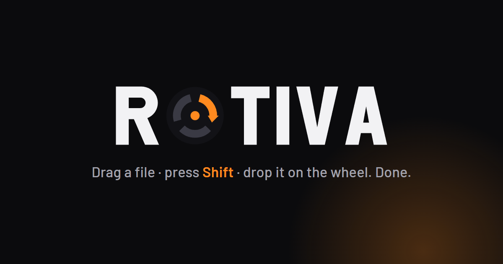
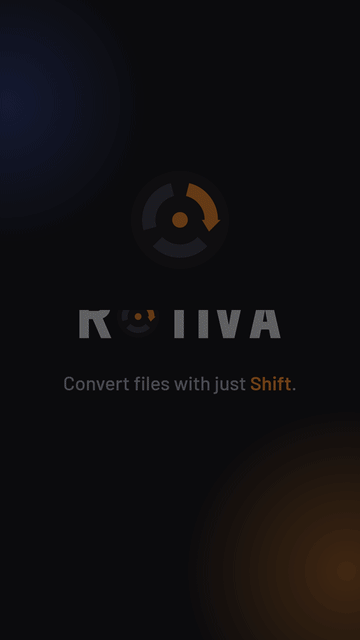
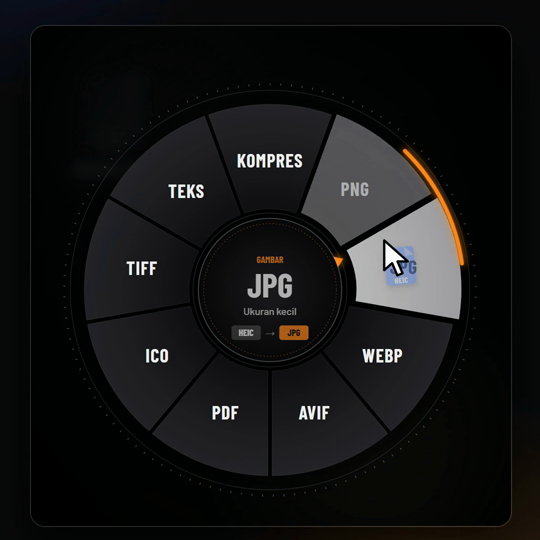
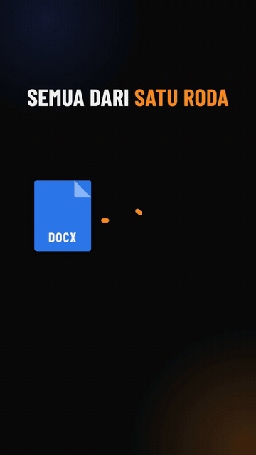

<!-- languages -->

  <a href="../../README.md">English</a> ·
  <a href="../../docs/readme/README.es.md">Español</a> ·
  <a href="../../docs/readme/README.ja.md">日本語</a> ·
  <a href="../../docs/readme/README.ko.md">한국어</a> ·
  <b>简体中文</b> ·
  <a href="../../docs/readme/README.zh-TW.md">繁體中文</a> ·
  <a href="../../docs/readme/README.pl.md">Polski</a> ·
  <a href="../../docs/readme/README.hi.md">हिन्दी</a> ·
  <a href="../../docs/readme/README.ru.md">Русский</a> ·
  <a href="../../docs/readme/README.ar.md">العربية</a> ·
  <a href="../../docs/readme/README.pt-BR.md">Português (Brasil)</a> ·
  <a href="../../docs/readme/README.pt-PT.md">Português (Portugal)</a> ·
  <a href="../../docs/readme/README.fr.md">Français</a> ·
  <a href="../../docs/readme/README.th.md">ไทย</a> ·
  <a href="../../docs/readme/README.tr.md">Türkçe</a> ·
  <a href="../../docs/readme/README.id.md">Bahasa Indonesia</a> ·
  <a href="../../docs/readme/README.it.md">Italiano</a>

<!-- /languages -->

  

  <b>无需打开任何应用即可转换文件。</b> 
  拖动文件，按下 <kbd>Shift</kbd>，放到转盘上——搞定。

  
  
  
  
  
  
  
  

  <a href="https://uncrownedk1ng2812.github.io/rotiva/"><b>🌐 网站与在线演示</b></a>
  &nbsp;·&nbsp;
  <a href="https://github.com/uncrownedk1ng2812/rotiva/releases/latest"><b>⬇️ 下载安装程序</b></a>
  &nbsp;·&nbsp;
  <a href="https://apps.microsoft.com/detail/9N5FPM017GN5"><b>🛍️ Microsoft Store</b></a>
  &nbsp;·&nbsp;
  <a href="https://ko-fi.com/denishchairany"><b>☕ 在 Ko-fi 上支持</b></a>

> 本文是[英文 README](../../README.md) 的翻译。如有出入，以英文版为准。

---

> [!NOTE]
> **Rotiva 由 Denish Chairany 从零开发**，以 [GPL-3.0](../../LICENSE) 协议开源。
> 欢迎 fork，但必须保持开源、注明原作者，并使用**不同的名称和标志**。
> 详见 [TRADEMARKS.md](../../TRADEMARKS.md)。

## Rotiva 是什么？

Rotiva 是一款常驻系统托盘的小应用。拖动照片、视频、文档或任何其他文件时按下 **Shift**，
光标旁就会弹出格式转盘。指向想要的格式后松开，转换好的文件就会保存在原文件旁边。

无需上传到在线转换网站，没有广告，也不用排队。

  
  &nbsp;&nbsp;
  

## 使用方法

| | 步骤 | 说明 |
|---|---|---|
| **1** | **拖动文件** | 可以从资源管理器、桌面或任意文件夹拖动。一个文件或多个文件都可以。 |
| **2** | **按下 <kbd>Shift</kbd>** | 保持按住鼠标左键。格式转盘会出现在光标旁边。 |
| **3** | **指向并松开** | 由光标的方向选择格式，不必精确落在某个扇区上。在中心松开即可取消。 |

更习惯右键？转盘上的所有选项也都在资源管理器右键菜单的 **Rotiva ▸** 中
（Windows 11：*显示更多选项*）。

## 支持的格式

转盘会根据拖动的文件自动调整，文件本身的格式会被自动隐藏。

| 类型 | 源格式 | 目标格式 |
|---|---|---|
| 🖼️ 图片 | PNG, JPG, WEBP, AVIF, HEIC, BMP, TIFF, GIF, ICO | PNG, JPG, WEBP, AVIF, PDF, ICO, TIFF, **压缩**, **文字 (OCR)** |
| 🎬 视频 | MP4, MKV, MOV, AVI, WEBM, WMV, FLV, 3GP | MP4, WEBM, MOV, MKV, AVI, GIF, MP3, WAV, **压缩** |
| 🎵 音频 | MP3, WAV, FLAC, OGG, OPUS, M4A, AAC, WMA | MP3, WAV, FLAC, OGG, OPUS, M4A |
| 📄 文档 | DOCX, DOC, ODT, RTF, TXT, MD, HTML | PDF, DOCX, ODT, TXT, HTML, MD, RTF |
| 📊 电子表格 | XLSX, XLS, CSV, TSV, ODS | XLSX, CSV, ODS, PDF, XLS, HTML |
| 📽️ 幻灯片 | PPTX, PPT, ODP, PPSX, PPS | PDF, PPTX, ODP, PNG, JPG |
| 📕 PDF | PDF | DOCX, ODT, PNG, JPG, **拆分**, **压缩**, **文字 (OCR)** |
| 🗜️ 压缩包 | ZIP, RAR, 7Z, TAR.GZ, … | **解压**, ZIP |

## 功能

  

- **压缩**——在不改变格式的情况下缩小照片、视频（MP4，最高 1080p）和扫描版 PDF。
- **合并为 1 个 PDF**——一次拖入多张图片、多个文档、表格或 PDF。
- **提取文字 (OCR)**——用 Windows 内置 OCR 识别图片或扫描版 PDF 中的文字，直接复制到剪贴板。
- **拆分 PDF**——每页一个 PDF，或将每页导出为 PNG/JPG。
- **ZIP 与解压**——把多个文件和文件夹打包成一个 ZIP；.zip、.rar、.7z 和 .tar.gz 一步解压。
- **轻快**——转盘是光标处的一个小窗口，没有全屏特效，即使在 4K 屏幕上也能瞬间打开。
  可在托盘菜单中选择 **S / M / L** 尺寸。
- **改主意了？** 回到转盘中心再松开，就不会转换任何东西。
- **100% 离线**——内置 FFmpeg、ImageMagick、Ghostscript、LibreOffice、Pandoc 和 7-Zip。你的文件永远不会离开电脑。

## 安装

1. 从 [Releases](https://github.com/uncrownedk1ng2812/rotiva/releases/latest) 下载 **`Rotiva-Setup-x.y.z.exe`**。
2. 运行安装程序。如果出现 SmartScreen，点击 **更多信息 → 仍要运行**
   （安装程序暂未使用付费代码签名证书签名）。
3. 在系统托盘中找到 Rotiva 图标，然后拖动文件并按下 <kbd>Shift</kbd>。

按用户安装到 `%LOCALAPPDATA%\Programs\Rotiva`，无需管理员权限，也无需安装 .NET。
卸载：*设置 → 应用 → 已安装的应用 → Rotiva*。

点击托盘图标即可打开 Rotiva 菜单：开机启动、资源管理器右键菜单、转盘尺寸，以及网站、GitHub 和支持链接。

### macOS 与 Linux

从 [Releases](https://github.com/uncrownedk1ng2812/rotiva/releases/latest) 下载 **macOS 版 `.dmg`**（Apple Silicon 或 Intel）
或 **Linux 版 `AppImage`**。
转盘和转换功能完全相同：右键点击文件 → **打开方式 → Rotiva**，或拖动文件并按下 <kbd>Shift</kbd>。
转换引擎使用系统中安装的版本（`brew install …` / `apt install …`），具体命令见发布说明。
macOS 版尚未经过公证（notarize），首次使用时请在 *系统设置 → 隐私与安全性* 中允许一次。

## 开源

Rotiva 以 **GPL-3.0** 协议开源。应用代码在 [`src/Rotiva`](../../src/Rotiva)（C# / .NET 8 / WPF），
安装程序在 [`installer/`](../../installer)。如需从源码运行或构建安装程序，请参阅 [BUILDING.md](../../BUILDING.md)。

欢迎在 [Issues](https://github.com/uncrownedk1ng2812/rotiva/issues) 提交 bug、想法和 pull request；
请参阅 [CONTRIBUTING.md](../../CONTRIBUTING.md) 和[行为准则](../../CODE_OF_CONDUCT.md)。安全问题请按照
[SECURITY.md](../../SECURITY.md) 中的说明私下报告。

## 代码签名

Windows 安装程序目前还没有代码签名，因此首次运行时 Windows SmartScreen 可能会显示警告。每个版本都在 `SHA256SUMS.txt` 中提供 SHA-256 校验和，方便你核对下载的文件。想要已签名的版本？Rotiva 也已上架 [Microsoft Store](https://apps.microsoft.com/detail/9N5FPM017GN5)，由 Microsoft 签名。

**隐私：** Rotiva 不会向网络中的其他系统发送任何信息。转换在你的电脑上完成；菜单中的链接（网站、GitHub、支持）
只有在你点击时才会打开浏览器。

## 内置引擎

Rotiva 使用以下出色的开源程序完成转换，它们按照各自的许可证随安装程序一起提供：

| 引擎 | 许可证 | 用途 |
|---|---|---|
| [FFmpeg](https://ffmpeg.org) | GPL-3.0 | 视频和音频 |
| [ImageMagick](https://imagemagick.org) | ImageMagick License | 图片 |
| [Ghostscript](https://ghostscript.com) | AGPL-3.0 | PDF 压缩、合并和拆分 |
| [LibreOffice](https://www.libreoffice.org) | MPL-2.0 | 文档、电子表格和幻灯片 |
| [Pandoc](https://pandoc.org) | GPL-2.0-or-later | Markdown、HTML 和 RTF |
| [7-Zip](https://www.7-zip.org) | LGPL-2.1-or-later | ZIP 和解压 |

版本、许可证文件和源代码链接：[THIRD-PARTY-NOTICES.md](../../THIRD-PARTY-NOTICES.md)。

## 支持 Rotiva

Rotiva 免费且无广告。如果它帮你节省了时间，欢迎在 Ko-fi 上
[请开发者喝杯咖啡](https://ko-fi.com/denishchairany) ☕。

## 版权与许可

Copyright © 2026 **Denish Chairany**。基于
[GNU General Public License v3.0](../../LICENSE) 授权。

- ✅ 可免费使用 Rotiva，无论个人还是商业用途。
- ✅ 可以学习、修改和分享代码。
- 🔁 你分发的修改版本也必须采用 **GPL-3.0 并附带完整源代码**，且必须保留版权声明。
- 🏷️ **Rotiva 的名称、标志和图标不在许可范围内。** fork 需要使用自己的名称和标志，并注明：
  `Based on Rotiva by Denish Chairany — https://github.com/uncrownedk1ng2812/rotiva`。
  详见 [TRADEMARKS.md](../../TRADEMARKS.md)。

内置引擎是各自拥有独立许可证的单独程序，列于
[THIRD-PARTY-NOTICES.md](../../THIRD-PARTY-NOTICES.md)。
